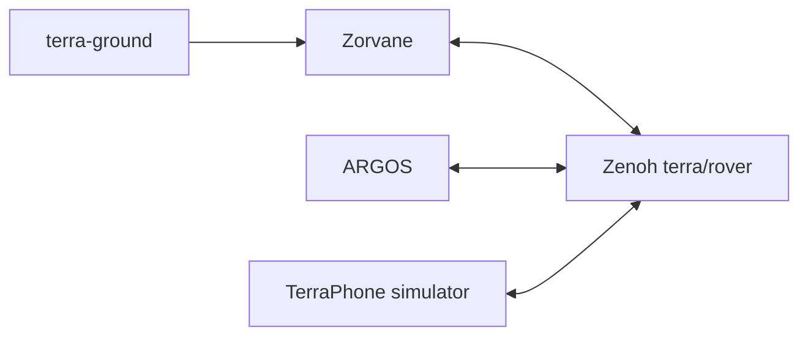

`git lfs pull`, then `cargo run -p zorvane` from the repository root. With no window, set `TERRA_HEADLESS=1`. Zenoh listens on `tcp/127.0.0.1:7447` unless you turn it off.

<figure>

<figcaption>The default window. One terra-ground rover. Zenoh is on unless you set TERRA_ZENOH=0.</figcaption>
</figure>

Rust 1.85 or newer, for edition 2024. You also need a C toolchain, pkg-config, and the Bevy window libraries.

```sh
sudo apt-get install -y pkg-config build-essential \
  libwayland-dev libxkbcommon-dev libvulkan-dev \
  libxcursor-dev libxrandr-dev libxi-dev libx11-xcb-dev \
  libasound2-dev libudev-dev
```

`rover.glb` is Git LFS, about 118 MB.

## Start a window

```sh
cargo run -p zorvane
```

W A S D drive only when Zenoh is off (`TERRA_ZENOH=0`). With Zenoh on, hold Space to zero the wheels.

## Start headless

```sh
export VK_ICD_FILENAMES=/usr/share/vulkan/icd.d/lvp_icd.x86_64.json
export WGPU_BACKEND=vulkan LIBGL_ALWAYS_SOFTWARE=1
TERRA_HEADLESS=1 TERRA_ZENOH=0 cargo run -p zorvane
```

`TERRA_HEADLESS=1` disables winit and steps the app on a timer. Rendering still asks Vulkan for a device. lavapipe is enough. `ZORVANE_SMOKE=1` exits after the world schedule starts. `bash scripts/run-headless.sh` sets those defaults.

## Start in Docker

```sh
git lfs pull
docker compose -f docker/compose.yaml up --build
```

The container is headless. Port 7447 is published on `127.0.0.1` only.

## Pick a world

With no switch, you get the practice town, 100 m across. The other two worlds replace it.

<figure>

<figcaption>Real elevation. TERRA_TILES=1. Grey boxes are steep cells.</figcaption>
</figure>

<figure>

<figcaption>NEXT practice pitch. TERRA_NEXT=1. Zatara, six balls, two buckets. It does not score a match.</figcaption>
</figure>

| Switch | You get |
| --- | --- |
| none | Practice town, 100 m |
| `TERRA_TILES=1` | Elevation patch around a map anchor |
| `TERRA_NEXT=1` | NEXT pitch, 32 m |

`TERRA_NEXT=1` wins over tiles and over the mission world. Layout details stay in the [Zorvane manual](https://super-yojan.dev/Zorvane/worlds/).

## Who talks to the world

The body plugs into the world. Operators use the same Zenoh keys as a rover.



A physical iPhone does not use this bus. It uses Bluetooth to the Pi. The simulator build of TerraPhone is the phone on the diagram.

Shared crates stay in Terra. Those crates are types, control, waypoint, transport, autonomy, and motors. The collider and `rover.glb` live in Zorvane.

## Drive from a second terminal

Leave Zenoh on.

```sh
python3 -m pip install -r simulator/tools/requirements.txt
python3 simulator/tools/zenoh_client.py --rover 0 drive --linear 0.4 --angular 0 --seconds 2
```

Client details and key names stay in the [Zorvane manual](https://super-yojan.dev/Zorvane/python-client/).

## Tests

```sh
cargo test --workspace
python3 -m unittest discover -s simulator/tools -p 'test_*.py'
```

GPU tests are marked `#[ignore]`. They write `/tmp/terra-world-preview.png`.

## Environment

Most runs set one switch. That switch is `TERRA_NEXT`, `TERRA_TILES`, or `TERRA_HEADLESS`. The rest have defaults.

`TERRA_HEADLESS` accepts `1` only. `TERRA_NEXT` and `TERRA_TILES` accept `1`, `true`, or `TRUE`. `TERRA_ZENOH=0` turns the bridge off. Any other value leaves it on.

| Variable | Default | Effect |
| --- | --- | --- |
| `ZORVANE_VEHICLE` | `terra-ground` | Registered body id. Unknown ids abort startup. |
| `ZORVANE_ASSETS` | `simulator/assets` | Asset root. |
| `ZORVANE_SMOKE` | unset | `1` exits once the schedule is running. |
| `TERRA_HEADLESS` | unset | `1` runs without a window. |
| `TERRA_NEXT` | off | NEXT pitch. Wins over tiles and mission. |
| `TERRA_TILES` | off | Terrarium elevation patch. |
| `TERRA_LAT` | `38.8297` | Tile anchor, degrees. |
| `TERRA_LON` | `-77.3075` | Tile anchor. Johnson Center. |
| `TERRA_ZOOM` | `15` | Slippy zoom, 9 through 15. |
| `TERRA_TILES_FETCH` | on | `0` uses the cache and the bundled tile only. |
| `TERRA_TILE_CACHE` | `simulator/.cache/tiles` | Tile cache. |
| `TERRA_WORLD_SIZE` | `100` | Metres. NEXT forces 32. Tiles need 40 through 512. |
| `TERRA_MISSION` | off | `1` loads seeded rubble on a flat square. |
| `TERRA_MISSION_SEED` | `42` | Landscape seed and rubble seed. |
| `TERRA_ROVER_COUNT` | `1` | Fleet size, 0 through 32. |
| `TERRA_ZENOH` | on | `0` disables the bridge. |
| `TERRA_ZENOH_PREFIX` | `terra/rover` | Topic prefix. |
| `TERRA_ZENOH_LISTEN` | `tcp/127.0.0.1:7447` | Peer listen endpoint. |
| `TERRA_ZENOH_CONFIG` | unset | JSON5 file. Replaces the session config. |
| `TERRA_RUN_DIR` | `runs` | Autonomy JSONL directory. |
| `TERRA_TRIAL_DESIGN` | `adaptive` | Stored in the run manifest. |
| `TERRA_ASSIGNED_LEVEL` | unset | JSON string for the arbiter level. |
| `TERRA_ZENOH_TEST_PYTHON` | unset | Interpreter for the ignored round-trip test. |
| `TERRA_TEST_ZENOH_ENDPOINT` | unset | Enables the live Python socket test. |
